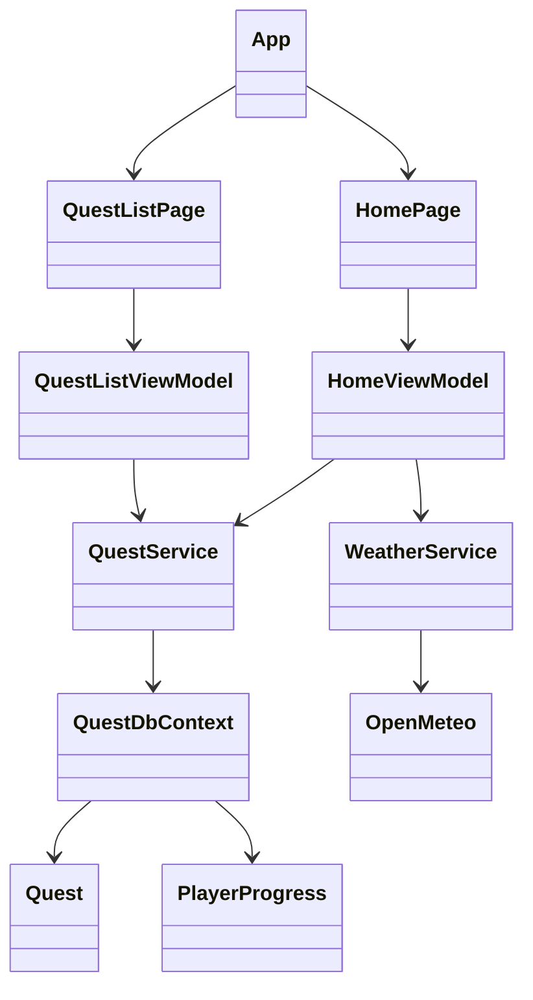

# Quest Life ? LifeManagementApp

Quest Life turns everyday to-dos into quests. Completing a quest earns XP and levels, while a home dashboard shows priorities and weather. This is a course project worth 50% of the course grade; the student must understand and be able to explain the whole app.

## Status and plan

The current MAUI code is an **unverified prototype**, not a completed assignment. It targets .NET 8 and constructs pages in C#; the course requires .NET 9 / MAUI 9 and XAML. Home currently includes completed quests when fewer than three remain unfinished, contrary to the brief. Build, runtime, persistence, weather and UI have not been verified because the .NET SDK was unavailable when the prototype was created.

The [GitHub issue backlog](https://github.com/Muruseni/ClientSideSim/issues) tracks the work. Priorities are: upgrade and build; implement XAML, Shell and CollectionView; correct unfinished top-three ordering and add editing; introduce interfaces and a category relationship; improve weather/error states; add compiled bindings, a converter and tests. Game styling and XP are extras and must not displace core requirements.

## Required behavior

- Home shows at most three unfinished to-dos ordered by highest priority, then earliest due date.
- Show current temperature and wind speed from Open-Meteo. Request `wind_speed_unit=ms` and show the kitesurf notice only for wind strictly above 5 m/s.
- List all to-dos in a CollectionView with priority and due-date sorting. Allow adding a to-do and reject blank titles. Each item has an ID, title, priority, due date and completion state.
- Use MAUI/XAML, MVVM and CommunityToolkit.Mvvm, SQLite with EF Core Code First, HttpClient REST calls, and dependency injection. The assessment also rewards Shell parameter navigation, a category relationship, interfaces, compiled bindings, a converter and xUnit tests.

## Current architecture

`MauiProgram` registers pages, view models, services, an HTTP client and an EF Core context factory. The service creates short-lived contexts for database operations. The present structure needs interfaces, separate model classes, XAML views and Shell to meet the intended design.

## Running the prototype

On Windows, install the .NET 8 SDK and MAUI workload to attempt the current prototype: `dotnet workload install maui`, then from this directory run `dotnet restore` and `dotnet build -t:Run -f net8.0-windows10.0.19041.0`. Windows MAUI development prerequisites are also needed. These commands have not yet been verified; upgrade to .NET 9 is tracked in issue #2. SQLite data is stored in the app data directory. Weather requires internet; no API key is used.

## Verification plan

Build and launch on Windows. Check blank titles, both sort orders, only unfinished top-three items, persistence after restart, and XP awarded once on completion. Exercise weather loading, offline failure and the 5 m/s boundary. Run xUnit tests once added. Record actual results rather than marking planned checks as passed.

## AI use and learning

OpenAI Codex was used to generate the initial MAUI prototype, identify gaps, document the plan and create issues. The code has not been independently verified. For the presentation, practice explaining how bindings connect a view to a view model, how DI supplies services, how EF Core persists data, and why the weather request specifies m/s. Review and test every AI-generated change.

## Git workflow

Create or select an issue for each feature, branch from current main, make descriptive commits, and open a PR referencing the issue. After review and merge, close or move the issue and delete the merged branch when project permissions and automation allow. See the repository's `AGENTS.md` for persistent working instructions.
